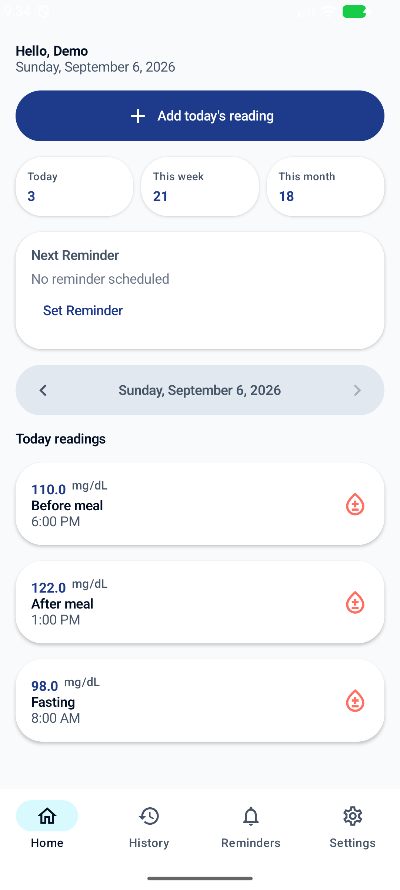
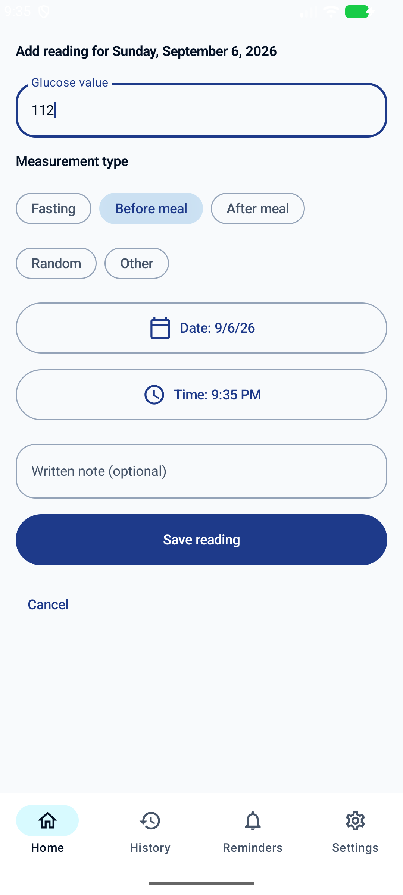
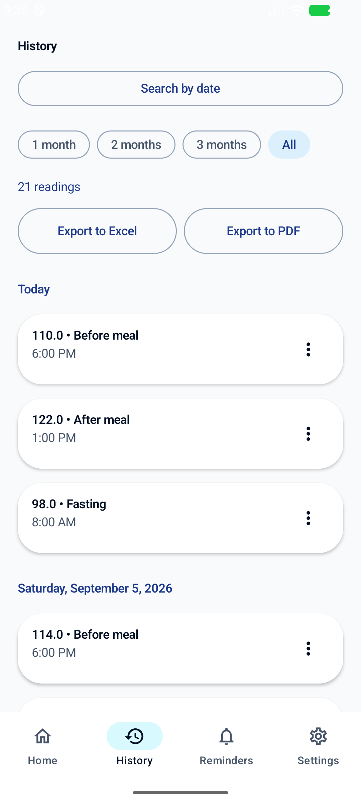
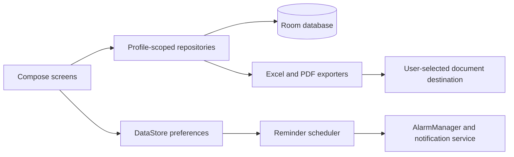

# GlucoTime

A personal Android project for recording blood-glucose readings and scheduling reminders, built by Hussein Nabil Akil. The application uses Kotlin, Jetpack Compose, Room, and DataStore. It is a logging and reminder tool; it does not provide diagnosis, treatment, insulin dosing, or emergency medical services.

## What is implemented

- Local profiles and profile-scoped readings, measurement types, timestamps, and notes.
- Reading history and statistical summaries.
- Configurable reminder times, day intervals, and selected weekdays.
- Alarm notifications, acknowledgement, and rescheduling after reboot/time changes.
- User-requested Excel (`.xlsx`) and PDF exports through Android's document picker.
- English and Arabic interfaces.

Snoozing was mentioned in earlier development notes but is not present in the inspected alarm flow. It is not advertised as a current feature.

## Screenshots

Existing native emulator captures show synthetic demo data, not patient information. Their provenance is recorded in the original local `play-store-assets/README.md`; these are historical captures rather than screenshots of a newly verified run.

<p>  </p>

## Architecture



Source entry points: `MainActivity.kt`, `data/GlucoseData.kt`, `data/GlucoseRepository.kt`, `reminders/ReminderScheduler.kt`, and `data/export/` under `app/src/main/java/com/sugartrack/`.

## Build and run

Use Android Studio with Android SDK 36 and a compatible JDK 21. Minimum device API is 26. The checked-in wrapper selects Gradle 9.5.0; the root build selects Android Gradle Plugin 9.3.1 and Kotlin Compose plugin 2.2.21. These are the actual project pins, not a claim of general compatibility.

```powershell
.\gradlew.bat testDebugUnitTest assembleDebug
```

Open the root directory in Android Studio, let dependencies resolve, select an emulator or device, and run the `app` configuration. Configure the SDK location locally; do not commit `local.properties`. Release signing uses `GLUCOTIME_KEYSTORE_PATH`, `GLUCOTIME_KEYSTORE_PASSWORD`, `GLUCOTIME_KEY_PASSWORD`, and optionally `GLUCOTIME_KEY_ALIAS`; keep them outside Git.

## Validation and limitations

Unit tests cover glucose-input validation and reminder date selection. They do not establish notification delivery, exports, accessibility, database migration correctness, or medical reliability on a real device. Build evidence is recorded in [verification](docs/VERIFICATION.md). No Google Play listing or published APK is claimed.

## Privacy

The inspected main manifest has no `INTERNET` permission and the implementation uses local Room/DataStore storage. The manifest enables Android backup (`allowBackup=true`), so device/OS backup policy must be considered before claiming records never leave the device. Exported files can contain sensitive health information and remain outside app-private storage.

The existing bilingual [privacy policy](https://enghusseinakil.github.io/glucotime-privacy/) describes developer-operated services and user-controlled exports. A privacy document alone does not prove runtime behavior. See [privacy and release review](docs/PRIVACY_AND_RELEASE.md).

## Contribution and next work

Personal project maintained by Hussein Nabil Akil. No teammate contribution is claimed. The imported source did not yet have a committed local baseline; this repository contains the selected source snapshot, excluding signing keys, build artifacts, IDE metadata, and development-agent records. Optional private phone/payment contact values in `DeveloperLinks.kt` are empty in this public snapshot; the original local application retains its settings.

Next: instrumented tests for reminders/reboot/migrations and export interoperability; explicit backup policy for health records; device testing and Play declarations for full-screen intent/exact alarms/foreground service before any release.
